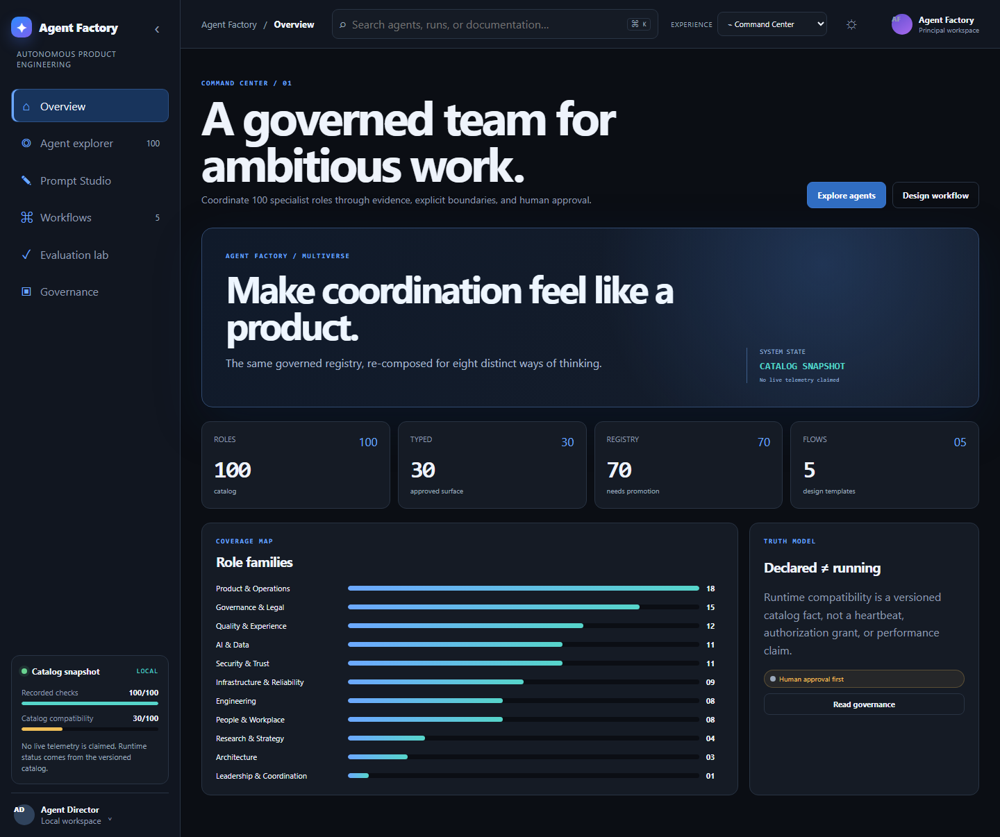
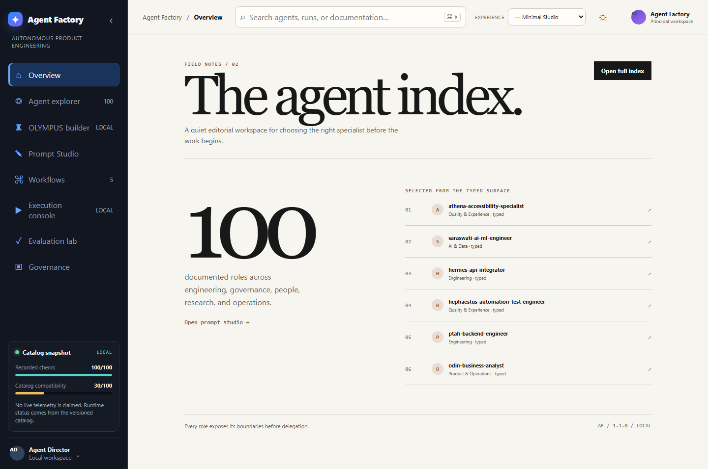
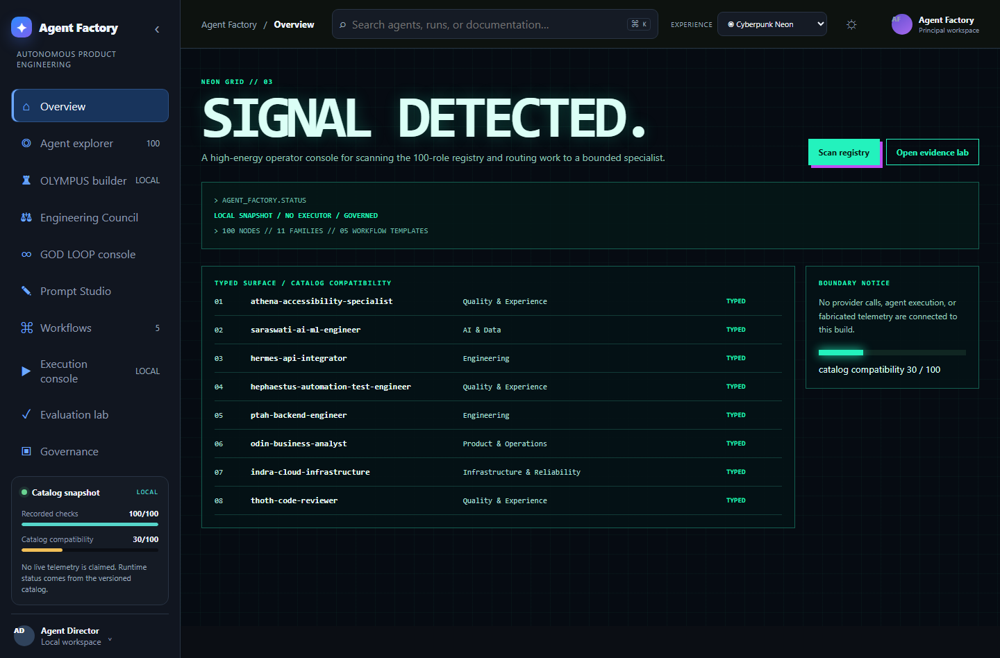
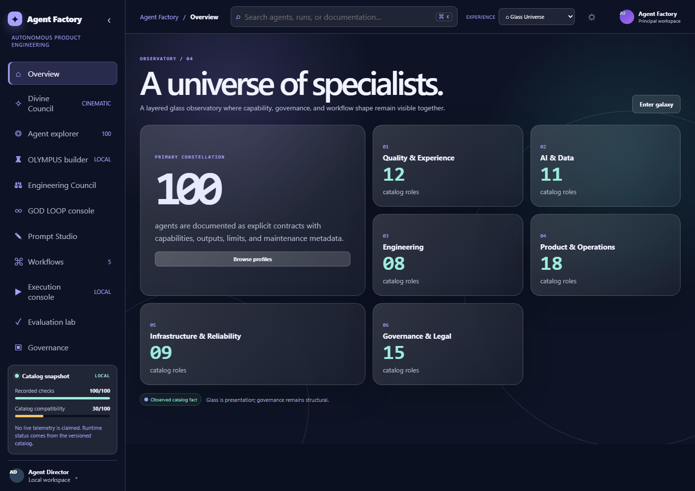
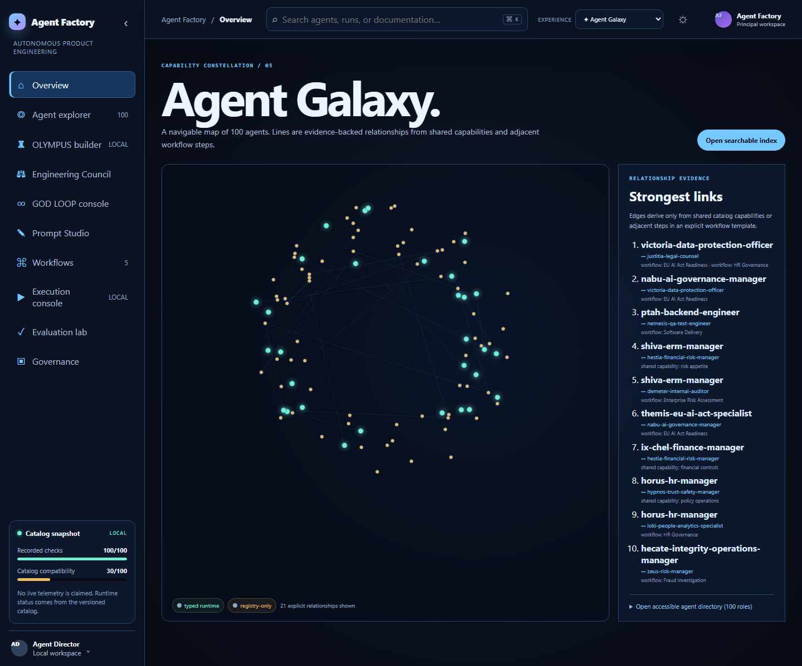
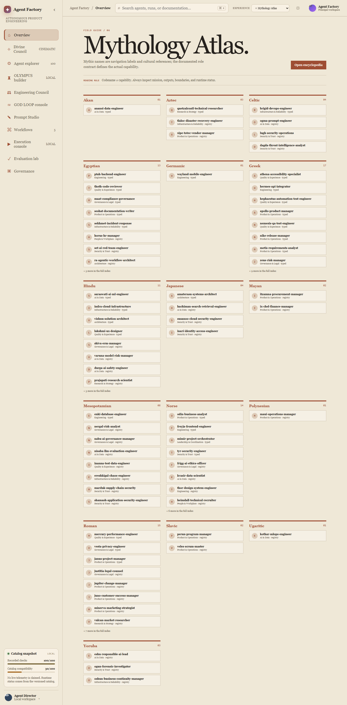
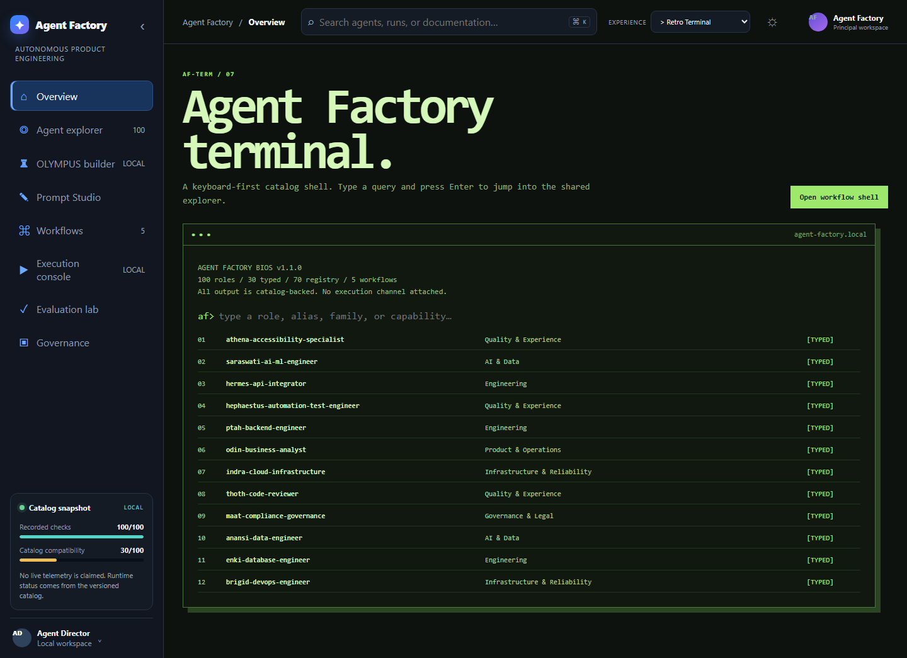
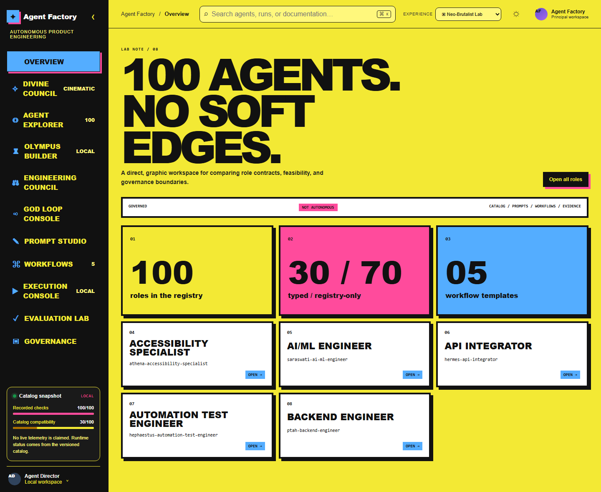
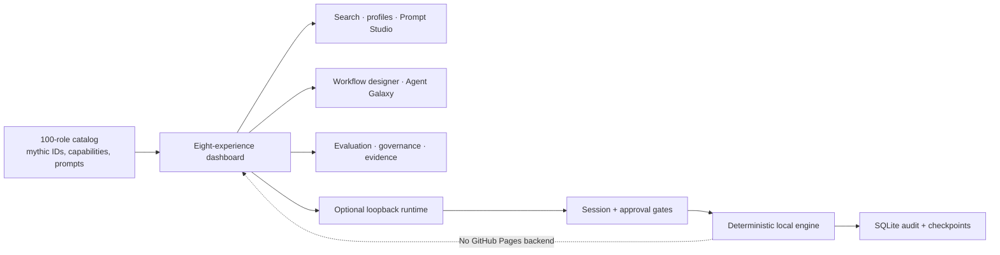

# AGENT//FACTORY

**100 Agent Identities. Eight Universes. One Governed Execution Engine.**

🚀 **[LAUNCH LIVE DASHBOARD](https://jeevan-0508.github.io/agent-factory/)**<br>
📖 **[DOCUMENTATION](docs/role-catalog.md)**<br>
🏗️ **[ARCHITECTURE](docs/architecture.md)**<br>
🛡️ **[SECURITY & GOVERNANCE](docs/security-model.md)**

[](https://github.com/Jeevan-0508/agent-factory/actions/workflows/validate.yml) [](https://github.com/Jeevan-0508/agent-factory/actions/workflows/pages.yml)

AGENT//FACTORY is an evidence-constrained catalog and local-first orchestration workspace for 100 specialist roles. The names are mythic navigation labels — `zeus-risk-manager`, `shiva-erm-manager`, `vishnu-solution-architect`, and `horus-hr-manager` — while each capability is defined by an explicit job contract, prompt, boundary, deliverable, and runtime status.

## The public dashboard

The live GitHub Pages dashboard is a static showcase. It includes the complete eight-experience explorer, search, role profiles, Prompt Studio, workflow design/export, evaluation evidence, Agent Galaxy, Mythology Atlas, and governance documentation. It does not execute agents, call providers, expose SQLite, or display private runtime telemetry.

## Eight universes

Each experience changes composition, typography, interaction language, and how the same registry is discovered — not just the color palette.

| Universe | Discovery language | Visual evidence |
| --- | --- | --- |
| Command Center | Governed operations and truth signals | [desktop](tests/e2e/visual.spec.mjs-snapshots/command-center-visual-desktop.png) |
| Minimal Studio | Editorial index and quiet comparison | [desktop](tests/e2e/visual.spec.mjs-snapshots/minimal-studio-visual-desktop.png) |
| Cyberpunk Neon | High-energy signal routing | [desktop](tests/e2e/visual.spec.mjs-snapshots/cyberpunk-neon-visual-desktop.png) |
| Glass Universe | Layered observatory panels | [desktop](tests/e2e/visual.spec.mjs-snapshots/glass-universe-visual-desktop.png) |
| Agent Galaxy | Evidence-backed capability constellation | [desktop](tests/e2e/visual.spec.mjs-snapshots/agent-galaxy-visual-desktop.png) |
| Mythology Atlas | Cultural reference and role encyclopedia | [desktop](tests/e2e/visual.spec.mjs-snapshots/mythology-atlas-visual-desktop.png) |
| Retro Terminal | Keyboard-first catalog shell | [desktop](tests/e2e/visual.spec.mjs-snapshots/retro-terminal-visual-desktop.png) |
| Neo-Brutalist Lab | Direct contract comparison | [desktop](tests/e2e/visual.spec.mjs-snapshots/neo-brutalist-lab-visual-desktop.png) |

### Gallery










Mobile evidence is retained beside the desktop snapshots in `tests/e2e/visual.spec.mjs-snapshots/`, including all eight experiences.

## Architecture



Lifecycle: `DRAFT → VALIDATED → AWAITING_APPROVAL → APPROVED → RUNNING → terminal`.

## What is implemented

- 100 catalog roles with stable IDs, mythic aliases, families, prompts, capabilities, deliverables, boundaries, and runtime metadata.
- Eight genuinely different presentation universes over one shared catalog and persisted browser state.
- Prompt Studio with copyable reusable prompts and role constraints.
- Workflow designer with explicit roles, outputs, gates, feasibility, JSON copy, and export.
- Agent Galaxy edges derived from shared catalog capabilities or explicit workflow adjacency; decorative connections are not presented as evidence.
- Mythology Atlas with a visible rule that codename is not capability.
- V4.1 local runtime with server-controlled authorization, approval transitions, cancellation, timeout, recovery checkpoints, graph validation, audit evidence, and a kill switch.
- Security, catalog, runtime, browser, accessibility, and visual regression coverage in CI.

## Honest limitations

- GitHub Pages is static-only. Backend-dependent execution, SQLite persistence, live tool calls, and private telemetry require the local runtime.
- 30 roles are typed runtime profiles; 70 remain registry-only until separately promoted by the host.
- No provider call or paid service is enabled by default.
- Legal, HR, risk, EU AI Act, and governance roles support structured research and issue spotting; they are not counsel, regulators, auditors, or accountable decision-makers.
- Exactly-once execution is not promised for non-idempotent external operations; inspect the workflow recovery documentation before relying on retries.

## Quick start

```text
npm install
npm test
npm run validate
npm run build:site
npm run test:security
npm run test:runtime
npm run test:e2e
npm run test:e2e:runtime
```

For the local runtime, run `npm run start:local` and open `http://127.0.0.1:8787/dashboard/`. The public dashboard is intentionally separate from that loopback execution surface.

## Documentation map

- [Role catalog](docs/role-catalog.md) · [Prompt library](docs/prompt-library.md) · [Governance](docs/governance.md)
- [Architecture](docs/architecture.md) · [Workflow lifecycle](docs/workflow-lifecycle.md) · [Runtime API](docs/runtime-api.md)
- [Security model](docs/security-model.md) · [Database schema](docs/database-schema.md) · [Evaluation methodology](docs/evaluation-methodology.md)
- [Visual comparison](docs/visual-comparison-v4.md) · [Installation](docs/installation.md) · [Provider adapters](docs/provider-adapters.md)

## Naming and cultural care

Mythic names are labels for navigation and thematic identity. They do not imply religious authority, cultural ownership, or capabilities beyond the documented role contract.

## Author

Built by [Jeevan-0508](https://github.com/Jeevan-0508). The source repository is public by design; the runtime remains local-first and evidence-constrained.
